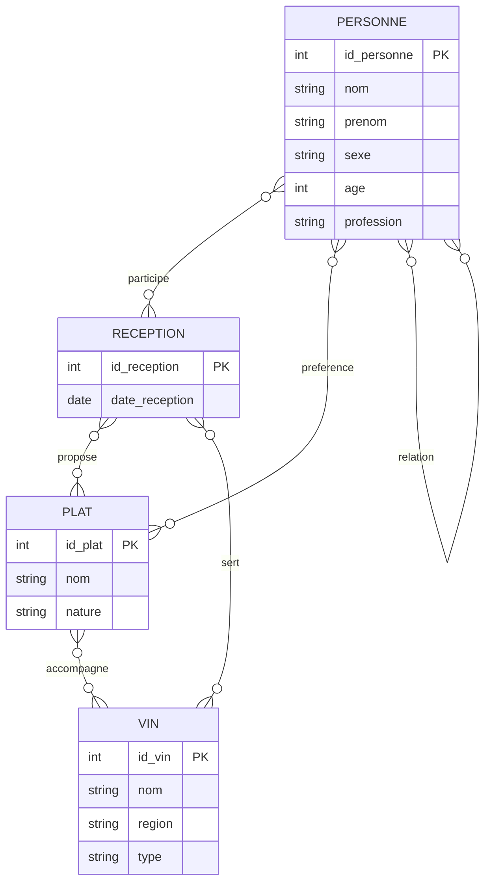

# Projet Réceptions

## 1. Modélisation statique

### 1.1 Modèle entités-associations

Ce diagramme représente les principales informations nécessaires pour organiser une réception.

### 1.2 Modèle relationnel

À partir du diagramme précédent, on obtient les tables suivantes.

**PERSONNE** (id_personne PK, nom, prenom, sexe, age, profession)

**RECEPTION** (id_reception PK, date_reception)

**PLAT** (id_plat PK, nom, nature)

**VIN** (id_vin PK, nom, region, type)

**INVITATION** (id_personne PK/FK, id_reception PK/FK)

**MENU_PLAT** (id_reception PK/FK, id_plat PK/FK)

**MENU_VIN** (id_reception PK/FK, id_vin PK/FK)

**ACCORD** (id_plat PK/FK, id_vin PK/FK)

**PREFERENCE** (id_personne PK/FK, id_plat PK/FK, apprecie)

**RELATION_PERSONNE** (id_personne1 PK/FK, id_personne2 PK/FK, type_relation)

### 1.3 Explications

- Une personne peut participer à plusieurs réceptions.
- Une réception peut accueillir plusieurs personnes.
- Une réception peut proposer plusieurs plats et plusieurs vins.
- Un plat peut être accompagné de plusieurs vins.
- Chaque personne peut aimer ou ne pas aimer certains plats.
- Deux personnes peuvent être amies ou ennemies.

### 1.4 Contraintes

- Une personne ne peut pas être invitée deux fois à la même réception.
- Un plat ne peut pas apparaître deux fois dans le menu d'une même réception.
- Une personne ne peut pas avoir une relation avec elle-même.
- Une relation entre deux personnes est enregistrée une seule fois.
- Le champ `apprecie` indique si une personne aime ou non un plat.
- Le champ `type_relation` indique une amitié ou une inimitié.